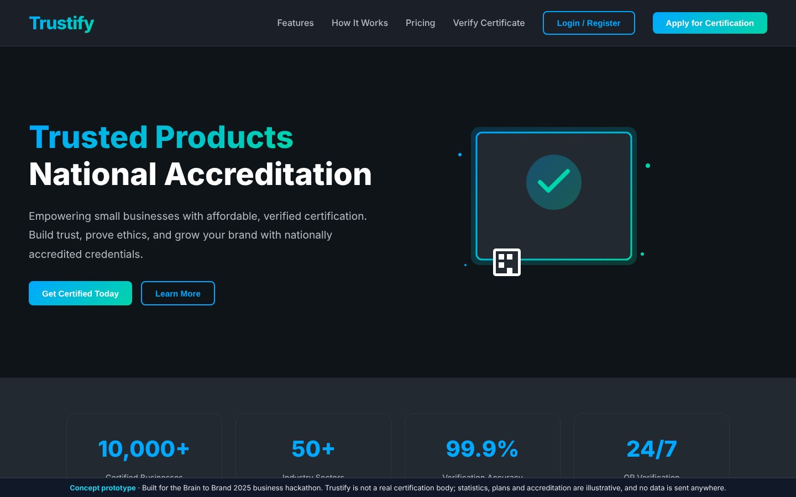
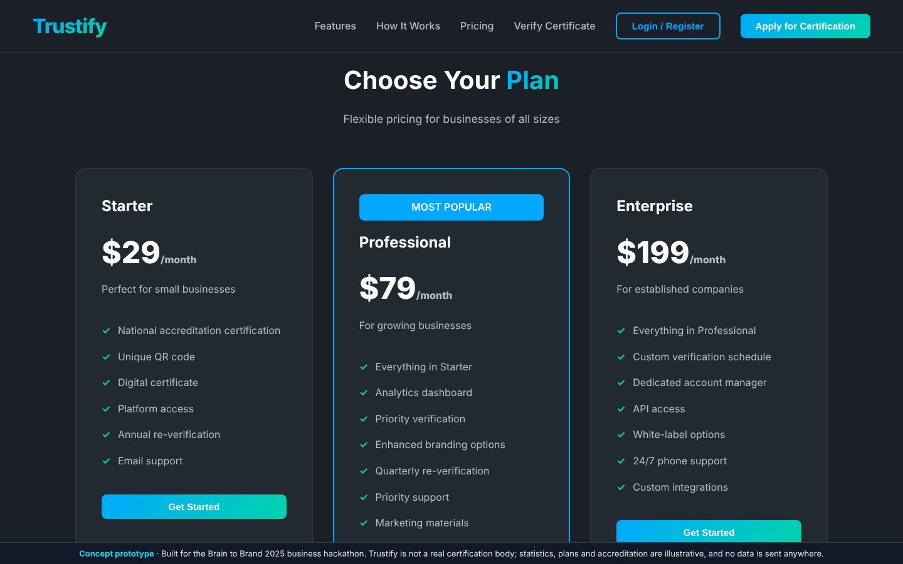
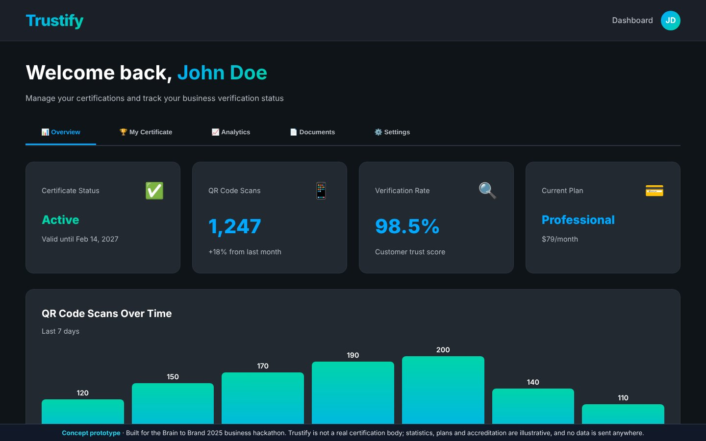
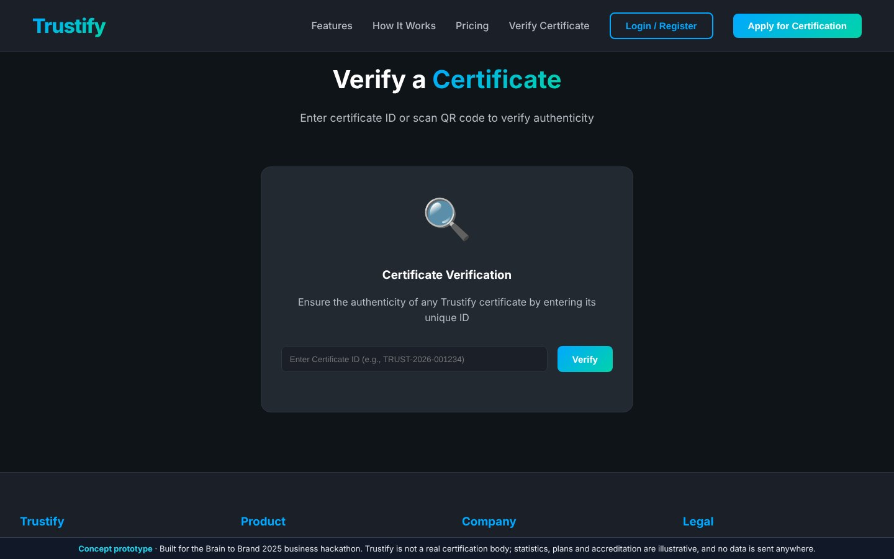

# Trustify

### Affordable, verifiable ethics and sustainability certification for small businesses

**Brain to Brand 2025 business hackathon finalist** · concept and working web prototype

-lightgrey)

> **Concept prototype.** Trustify is a hackathon business concept, not a real certification body. The statistics, plans, accreditation wording and dashboard figures in the prototype are illustrative, and the forms send no data anywhere.

---

## The problem

Small vendors, from a local food producer to a neighbourhood pharmacy, struggle to prove they are trustworthy. Big brands can afford audits and marketing. A small business usually cannot, so customers fall back on reputation and guesswork.

## The idea

Trustify is a nationally accredited (NABCB-style) **ethics and sustainability certification** priced for small businesses:

- **Sector-specific standards** for Agri, Food, Pharma, Healthcare and Retail, with quality levels **A / F / U**
- **QR-verifiable certificates.** Any customer can scan a product or storefront code and check the certificate instantly
- **Periodic and complaint-triggered audits** keep certifications credible over time
- A **business dashboard** shows certificate status, QR-scan analytics, documents and renewals

### Why a dedicated certifier and not an existing brand?

In the final round, a judge asked why a brand such as Michelin couldn't simply certify restaurants itself. Our answer:

- Elite certifiers mark businesses as **exclusive**, not **trustworthy**.
- Protecting their brand value means they would rarely certify the small businesses that most need trust.

Trustify is built for that gap. This argument took the team to the finals.

## Business model (from the pitch deck)

| Tier | Onboarding | Subscription |
|---|---:|---:|
| Micro vendors | ₹2,000 | ₹499 / month |
| Small businesses | ₹25,000 | ₹3,999 / month |
| Large / pharma / hotels | ₹1,00,000 | ₹15,000 / month |

At 1,000 clients the model projects **about ₹3.1 Cr in annual revenue**, a **60–65% gross margin** and a **CAC payback of about 3–4 months**. The prototype UI shows placeholder USD plans.

## The prototype

A complete single-file web app (`index.html`, no dependencies, no build step). It includes:

- Landing page, features, how-it-works and pricing
- Login and registration and the certification application flow, simulated on the client side
- Business dashboard with Overview, My Certificate, Analytics, Documents and Settings tabs
- Public certificate-verification page

| Pricing | Business dashboard | Certificate verification |
|---|---|---|
|  |  |  |

**Run it.** Open `index.html` in any browser.

## Team and outcome

The team built this for **Brain to Brand** (14 February 2025) and reached the final round as a **finalist**. The team designed the pricing together, and I answered the judges' challenge in the final round (above). This repository holds the web prototype we used in the demo.

---

<b>Sai Siddhanth</b> · VIT Vellore 
<a href="https://www.linkedin.com/in/sai-siddhanth-67912628b">LinkedIn</a> · <a href="https://github.com/saisiddhanthks">GitHub</a>

